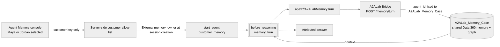

# Agent Spec: A2ALab_Customer_Memory_Agentforce

**Status:** Approved by D121 for implementation. This is the lab-local third Agent Memory experiment. It does not
connect to or depend on the DC1 estate.

## Purpose & Scope

Add a dedicated Agentforce Service Agent as the third participant in the existing customer-memory
exhibit. It reads and writes the exact same Data 360 Agent Configuration used by the Claude and
OpenAI faces:

- **registration / agent id:** `A2ALab_Memory_Case`
- **data space:** the lab's configured `A2ALAB_MEMORY_DATA_SPACE` (currently `default`)
- **owner:** the same server-resolved Maya or Jordan CRM Contact id from
  `A2ALAB_MEMORY_CUSTOMER_MAP`
- **categories:** the same governed facts, preferences, conversation generation, and attached
  Customer360/POS graph used by the existing pair

The Agentforce bundle is execution provenance only. It must not create a separate Agentforce memory
registration or use Agentforce native memory. The explicit `A2ALabMemoryTurn` action passes
`A2ALab_Memory_Case` on every turn.

## Behavioral Intent

- Run the memory action deterministically in `before_reasoning`; recall and ingestion must not
  depend on the planner choosing a tool.
- Read context before reasoning, then ingest the current user message into the shared registration.
- Label remembered conversational information as `From shared memory:` and live graph/CRM profile
  information as `From system of record:`. Never blur the two.
- Never invent recall. Distinguish an empty successful context from an unavailable memory call.
- Accept durable facts, preferences, and corrections, but do not expose any CRM mutation action in
  v1. A remembered recommendation is context, not authorization.
- Fail open: a memory outage removes context from the turn but does not prevent a response.
- Answer in one to three concise sentences so the result compares cleanly with the Claude and
  OpenAI panes.
- Store only the user side through the Agentforce hook. D89 established that Agent Script has no
  usable final-reply variable; the exhibit must not claim Agentforce replies were ingested.

## Subagent Map

This is a single-subagent agent. There are no transitions, so no conversation path can bypass the
memory hook.

## Variables

- `memory_owner` (`mutable string`, External, safe non-customer default) — set only by the trusted
  lab backend when it creates the Agentforce session. The browser supplies an allow-listed customer
  key, never a raw owner id.
- `memory_conversation` (`mutable string = ""`) — memory conversation/session id returned by the
  action and threaded across later turns in the same Agentforce session.
- `memory_context` (`mutable string = ""`) — Data 360 context returned for this turn and supplied to
  reasoning.
- `memory_ok` (`mutable boolean = False`) — action result used to distinguish unavailable memory
  from successful empty recall.
- `memory_generation` (`mutable string`, External) — the current D107 generation marker supplied
  at Agent API session creation and checked again by the bridge.
- `memory_correlation` (`mutable string`, External) — the lab session correlation carried through
  Apex into the bridge/memory trace.

## Actions & Backing Logic

### `memory_turn` (`customer_memory` subagent)

- **Target:** `apex://A2ALabMemoryTurn`
- **Backing Status:** **EXISTS** —
  `salesforce/force-app/main/default/classes/A2ALabMemoryTurn.cls`
- **Execution:** deterministic `before_reasoning`, once per reasoning pass
- **Route:** Apex → `A2ALab_Bridge` Named Credential → bridge memory endpoint → Data 360 tenant

#### Inputs

| Name | Type | Required | Source |
|---|---|---:|---|
| `userMessage` | string | No | `@system_variables.user_input` |
| `ownerId` | string | Yes | `@variables.memory_owner` |
| `conversationId` | string | No | `@variables.memory_conversation` |
| `agentApiName` | string | No | fixed `A2ALab_Memory_Case` |
| `generation` | string | No | `@variables.memory_generation` |
| `correlationId` | string | No | `@variables.memory_correlation` |
| `agentResponse` | string | No | omitted; no correct Agent Script reply source exists |

#### Outputs

| Name | Type | Visible to User? | Use |
|---|---|---:|---|
| `conversationId` | string | No | update `memory_conversation` |
| `context` | string | Yes | update `memory_context`; ground reasoning |
| `ok` | boolean | No | update `memory_ok`; disclose outage |
| `traceId` | string | No | correlate Agentforce, bridge, and tenant hops |

The backing-logic scan found no new Flow, Prompt Template, or custom object. D121 extends the
existing Apex request with optional generation and correlation inputs; the Agent Script binds all
three fixed/trusted fields instead of relying on the concierge default.

## Gating and Identity Boundary

- `memory_turn` is not available as a reasoning action; the model cannot skip it or call it twice
  intentionally.
- No consequential action is exposed in v1.
- The raw owner id remains server-side. The console resolves an allow-listed `memory_customer` key
  using the same mapping already used by the Claude/OpenAI experiments.
- Agentforce receives `memory_owner` only at session creation. A cached Agentforce session is bound
  permanently to that owner; changing the selected customer creates a new session instead of
  mutating an existing one.
- This is the lab's existing D115 internal-caller boundary, not a recommendation for an anonymous
  customer-facing service agent. A future public channel should use verified participant identity.
- The bridge accepts only `A2ALab_Memory_Case` and owners present in
  `A2ALAB_MEMORY_CUSTOMER_MAP`; a missing or sentinel binding performs no tenant call.

## Agent Configuration

- **developer_name:** `A2ALab_Customer_Memory_Agentforce`
- **agent_label:** `A2ALab Customer Memory (Agentforce)`
- **agent_type:** `AgentforceServiceAgent`
- **default_agent_user:** `{{env:SF_MEMORY_AGENT_RUNAS_USER}}`, resolved to the established
  research-assistant Einstein Agent User at publish time
- **native `context.memory`:** `False`
- **native `context.past_conversations`:** `False`
- **architecture:** single-subagent with deterministic pre-reasoning hook

## Third Console Experiment

Add this scenario after the existing Claude and OpenAI entries under the `agent-memory` group:

- **id:** `customer-memory-agentforce`
- **title:** `Customer memory — Agentforce recalls`
- **target:** a dedicated registry target for the new Agentforce bundle, using the existing Agent
  API credentials and a separate agent id
- **customer selector:** same Maya/Jordan selector and curation controls as the existing pair
- **memory state:** always handled inside the target agent; do not wrap it in `MemoryAdapter` or
  suggest that the console toggle controls the hook
- **seed prompt:** recall the rollout constraint and checklist preference, identify the source, and
  state that no CRM action was requested
- **flow:** console → Agentforce Agent API → `A2ALabMemoryTurn` → bridge →
  `A2ALab_Memory_Case`

The scenario should display a small `Shared memory always on` treatment rather than the existing
generic on/off toggle. The Details pane should explain that Claude/OpenAI use the generic REST seam,
while Agentforce uses the explicit Apex hook, but all three address the same registration and owner.

## Runtime Integration Requirements

The existing `AgentforceClient.session_variables` is fixed when the client is constructed. The new
target needs request-scoped, trusted session-variable resolution:

1. Resolve `memory_customer` through the existing server-side map.
2. Create the Agentforce session with `memory_owner` set to that resolved owner.
3. Create it with the current generation and lab correlation as External variables.
4. Store an immutable `(owner, generation)` fingerprint with the cached session.
5. End and refuse with `stale_memory_generation` if the expected generation changes.
6. Refuse reuse if the same lab session id is presented with a different owner.
7. Ensure concurrent Maya/Jordan starts cannot mutate shared client state or exchange bindings.
8. Keep the real Agentforce session id and joined memory evidence in response metadata.

The target should use a separate environment variable such as `SF_MEMORY_AGENT_ID`; it must not
replace `SF_AGENT_ID`, which identifies the existing research assistant used by other experiments.

## Acceptance Scenarios

1. **Claude → Agentforce recall:** Start fresh for Maya, teach Claude a run-unique fact, wait for
   extraction, then ask Agentforce. It recalls the fact from `A2ALab_Memory_Case`.
2. **Agentforce → OpenAI recall:** Tell Agentforce a run-unique preference, start a fresh OpenAI
   session, and confirm OpenAI recalls it under the same owner.
3. **Three-agent correction:** Claude stores 90 days, Agentforce corrects it to 60, and OpenAI
   presents 60 as current without presenting 90 as current.
4. **Negative owner control:** Jordan does not receive Maya's run-unique marker.
5. **Start fresh:** after generation rotation, the first Agentforce turn receives no eligible
   pre-reset conversation context.
6. **Real-time graph:** ring up a POS item and have Agentforce identify it as system-of-record
   context, not remembered conversation.
7. **Memory outage:** `ok=false` produces an explicit availability disclosure and no invented
   memory.
8. **Authority boundary:** remembered Case guidance alone never creates a Case.
9. **Session isolation:** concurrent Maya and Jordan sessions retain their original owners across
   multiple turns.
10. **Trace evidence:** the run shows Agent API, Apex/bridge, and tenant memory hops joined by the
    expected trace/session identifiers.

## Best Live Story

Use a three-step relay while preserving each experiment as independently runnable:

1. **Teach Claude** the preference and constraint.
2. **Agentforce recalls and corrects** the constraint from the same memory.
3. **OpenAI recalls the correction** and, only when explicitly requested, delegates the existing
   separate Agentforce CRM Case action.

This shows shared memory, correction, vendor handoff, and the separation between memory and action
without involving the DC1 estate.

## Delivery After Approval

1. Record the settled scope in an ADR and new WS item lines; create the D79 handoff batch.
2. Verify the target org and confirm the Einstein Agent User.
3. Generate the authoring bundle with `sf agent generate authoring-bundle --json`; do not hand-create
   its metadata.
4. Implement the Agent Script using the existing `A2ALabMemoryTurn` action.
5. Validate compilation, then preview with `--use-live-actions` and inspect traces.
6. Add the dedicated registry target, request-scoped owner binding, concurrency tests, scenario,
   Details/presentation copy, diagrams, deployment map, and Docker image coverage.
7. Request explicit deployment approval before publishing or activating the new agent.
8. Run all acceptance scenarios and record measured evidence in `plan/03-results.md`.

## Parked Future Extension

The DC1 home/companion crossover remains useful later as a separate cross-estate scenario. Its
parked design is in `build-notes/codex/agentforce-customer-memory-agent-spec.md`; it is explicitly
outside this scope.
