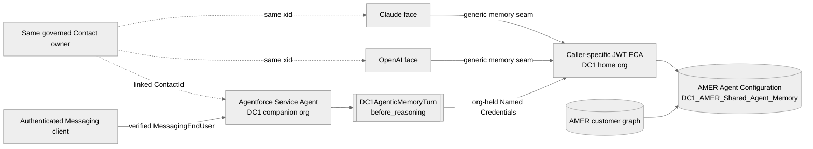

# Agent Spec and Integration Plan: DC1_AMER_Shared_Agent_Memory

**Status:** PARKED on 2026-11-13 at the operator's direction. This is a future cross-estate
extension, not the Agentforce third lane for the current A2A Lab customer-memory exhibit. No work
from this document should enter the active implementation scope without a new operator decision.

## Recommendation

Do not create another Agentforce memory agent in the A2A org. Reuse the existing
`DC1_AMER_Shared_Agent_Memory` Service Agent in the DC1 companion dev2 org, and point the A2A lab's
Claude and OpenAI memory paths at that agent's existing `DC1_AMER_Shared_Agent_Memory`
Agent Configuration in the DC1 home tenant.

That produces the stronger exhibit:

- one non-default `AMER` Data 360 memory/configuration in the DC1 home org;
- Agentforce reading and writing it from a Data Cloud One companion org through org-held credentials;
- Claude and OpenAI reading and writing it as external runtimes through the lab memory seam;
- one governed CRM Contact owner shared across all three participants.

This also closes the DC1 experiment's remaining real-agent T4 gap: the Service Agent is active, and
its Apex path has passed direct customer recall and isolation tests, but customer recall through the
actual agent still needs an authenticated Messaging surface to populate `@MessagingEndUser.ContactId`.

## Existing Agent

- **developer_name:** `DC1_AMER_Shared_Agent_Memory`
- **agent_label:** `DC1 AMER Customer Memory`
- **agent_type:** `AgentforceServiceAgent`
- **location:** DC1 dev2 companion org
- **status:** Published and active, version 1, verified 2026-11-13
- **memory registration:** `DC1_AMER_Shared_Agent_Memory`
- **data space:** `AMER` in the DC1 dev2 home Data Cloud tenant
- **native Agentforce memory flags:** Off; recall is attributable to the explicit Data 360 route
- **source bundle:**
  `/Users/ryan.cox/projects/dcunited-dc1/stage1-dev/dc1-companion-amer-sales-sandbox-dev2/force-app/main/default/aiAuthoringBundles/DC1_AMER_Shared_Agent_Memory/DC1_AMER_Shared_Agent_Memory.agent`
- **backing Apex:**
  `/Users/ryan.cox/projects/dcunited-dc1/stage1-dev/dc1-companion-amer-sales-sandbox-dev2/force-app/main/default/classes/DC1AgenticMemoryTurn.cls`

## Purpose & Scope

The agent answers from an authenticated customer's governed Data 360 memory and current customer
graph. It labels remembered conversational information as `Memory:` and current graph information
as `Customer graph:`. It stores the user's current turn for later extraction and never treats a
remembered request as current authorization.

No Agent Script change is needed for the first A2A showcase. The work is identity, channel, and
cross-runtime integration around the already-active agent.

## Behavioral Intent

- Execute `memory_turn` deterministically in `before_reasoning` on every turn.
- Resolve the customer owner only from the linked, read-only
  `@MessagingEndUser.ContactId`; never accept an External owner variable or planner-provided id.
- Revalidate that owner in Apex as a syntactically valid, locally visible Contact using
  `WITH USER_MODE`. Invalid or missing identities make zero memory callouts.
- Read and write `DC1_AMER_Shared_Agent_Memory` in the `AMER` data space.
- Clearly separate extracted memory from live customer-graph values.
- Fail open on memory errors, without inventing context.
- Require current-turn confirmation before any consequential action. The current bundle exposes no
  CRM mutation action, so this boundary is structural as well as instructional.
- Store the user side only. Agent Script has no correct final-response variable for the reply path.

## Subagent and Runtime Map

The Agentforce bundle is intentionally single-subagent. No transition can bypass its deterministic
memory hook.

## Variables

- `ContactId` (linked string) — sourced from `@MessagingEndUser.ContactId`; read-only owner input to
  the Apex action. This is the critical identity boundary.
- `memory_conversation` (`mutable string = ""`) — threads the Data 360 session id between turns.
- `memory_context` (`mutable string = ""`) — contains the rendered memory and graph context used by
  the reasoning prompt.

## Action and Backing Logic

### `memory_turn` (`customer_memory` subagent)

- **Target:** `apex://DC1AgenticMemoryTurn`
- **Backing Status:** **EXISTS, DEPLOYED, TESTED**
- **Execution:** deterministic `before_reasoning`
- **Credential path:** companion certificate and JWT External Credential → home-org ECA →
  `/services/a360/token` with registration `aid` and customer `xid` → tenant Agentic APIs
- **Bridge:** none. Runtime private keys remain in Salesforce.

#### Inputs

| Name | Type | Required | Source |
|---|---|---:|---|
| `userMessage` | string | No | `@system_variables.user_input` |
| `ownerId` | string | Yes | linked `@variables.ContactId` |
| `ownerType` | string | Yes | fixed `individual` |
| `conversationId` | string | No | `@variables.memory_conversation` |
| `agentResponse` | string | No | omitted; no correct final-reply source exists |

#### Outputs

| Name | Type | Visible to User? | Use |
|---|---|---:|---|
| `conversationId` | string | No | persist across turns |
| `context` | string | Yes | ground the response |
| `ok` | boolean | No | fail-open state |
| `traceId` | string | No | call correlation |

## Identity and Security Boundary

The earlier A2A draft proposed an External `memory_owner`; the DC1 evidence shows why that is the
wrong default for a customer-facing Agentforce agent. The internal Agentic Memory token does not
independently enforce `profile_id = xid`. A caller-selected owner can therefore become a
cross-profile read primitive.

The showcase must preserve two equivalent governed bindings:

1. **Agentforce:** authenticated Messaging user → linked `MessagingEndUser.ContactId` → local
   Contact access check in Apex.
2. **Claude/OpenAI:** authenticated lab operator chooses an allow-listed synthetic DC1 customer →
   server-side mapping resolves the exact same DC1 companion Contact id. The browser never supplies
   or receives the raw owner id.

The acceptance evidence must prove the Contact id used by both routes resolves to the same owner in
the DC1 home tenant. Display a friendly persona name only.

## Required Integration Work

### 1. Finish the authenticated Agentforce surface

Create or reuse an authenticated Experience Cloud / Messaging for In-App and Web surface for the
active DC1 companion Service Agent. Configure User Verification and Contact linkage so the agent
receives `@MessagingEndUser.ContactId`. Embed that client in the A2A console or open it as a
deliberately linked sidecar. Agent API preview is not sufficient: it cannot populate the linked
Contact variable and correctly returns no customer memory.

### 2. Add a DC1 memory profile to the A2A lab

The existing Claude/OpenAI scenarios point at the A2A org's `A2ALab_Memory_Case`. Add a named,
scenario-scoped memory profile for the DC1 home tenant instead of changing the global default:

- registration/agent id: `DC1_AMER_Shared_Agent_Memory`;
- data space: `AMER`;
- home My Domain and tenant host from server-side configuration;
- caller-specific JWT/ECA credentials issued by the DC1 home org;
- allow-listed customer mapping to the matching DC1 companion Contact.

Use separate external credentials for the A2A runtime; do not copy Salesforce's non-exportable
companion private key. Keep Claude and OpenAI on the existing generic memory seam, with raw memory
wire hops traced as they are today.

This requires a real profile-aware refactor, not only more environment variables. The current
`MemoryClient` reads one global My Domain, signing key, client id, run-as user, data space, and
customer map, and `MemoryAdapter` shares one process-wide client. The implementation must select an
immutable memory profile per scenario/request without mutating shared process environment or
crossing token/session caches between the A2A and DC1 tenants.

### 3. Add the console scenario

Add `customer-memory-agentforce-dc1` as the third lane beside teach-Claude and OpenAI-recalls. Reuse
the customer selector UX, but populate it from a DC1-specific public persona list. Do not reuse
Maya/Jordan unless those exact people and owner mappings exist in the DC1 tenant.

The Details pane must say plainly that this lane crosses both a vendor boundary and a Data Cloud
One org boundary: Agentforce runs in the companion, while memory and its graph live in the home
tenant.

## Acceptance Scenarios

1. **Claude → Agentforce:** Claude stores a run-unique preference under the DC1 Contact; after
   extraction, the authenticated Agentforce session recalls it as `Memory:`.
2. **Agentforce → OpenAI:** Agentforce stores a run-unique preference; a fresh OpenAI session recalls
   it from the same registration and owner.
3. **Three-agent correction:** Claude stores 90 days, Agentforce corrects to 60, and OpenAI reports
   60 as current without presenting 90 as current.
4. **Customer isolation:** a second authenticated Contact sees none of the first Contact's marker.
5. **Graph versus memory:** change a graph-only marker without mentioning it in chat. All agents see
   the new `Customer graph:` value while the stored preference remains unchanged.
6. **Non-default space:** capture that every successful hop uses `AMER`, not `default`.
7. **Fail-closed identity:** blank, malformed, User-id, and inaccessible Contact inputs make zero
   Agentic Memory callouts.
8. **Fail-open memory:** a memory outage removes context but does not produce invented recall.
9. **Authority boundary:** a remembered recommendation does not trigger a write without explicit
   current-turn authorization.
10. **Forget/cache honesty:** after deleting a memory, show both the Memory API result and GetContext
    snapshot state. Do not claim immediate forgetting; DC1 observed deleted rows linger in
    GetContext for at least 40 minutes.

## Best Showcase Sequence

Use a three-step relay for the live presentation and keep the full ordered-pair matrix as evidence:

1. **Claude teaches** a preference to the DC1 customer.
2. **Agentforce recalls and corrects** it from the Data Cloud One companion customer channel.
3. **OpenAI recalls the correction** and, only after an explicit current-turn request, may delegate
   a separate CRM action to the existing A2A Agentforce research assistant.

Then switch to the second Contact as the negative control. This is more compelling than three
independent recall cards because the audience sees continuity, correction, governance, and action
authorization in one short narrative.

## Existing Evidence and Remaining Gap

Already verified in DC1 dev2 on 2026-11-13:

- non-default `AMER` memory create/read/delete and GetContext;
- conversation ingestion and extraction to a preference within 25 seconds;
- customer A recall and customer B isolation through the exact Apex action path;
- real Employee Agent recall;
- companion Service Agent published and active;
- customer graph returned through the companion action.

Not yet verified:

- customer recall through the real Service Agent with authenticated Messaging identity;
- Claude/OpenAI using the DC1 tenant and registration;
- the three-way cross-runtime relay;
- DC1 cross-org recall through both agent surfaces;
- cache convergence after deletion (only a lower bound is measured).

## Approval Gate and Delivery

This plan intentionally makes no Agent Script or org changes. If approved:

1. Record the cross-repository scope in an ADR and WS item lines, then open a D79 handoff batch.
2. In the DC1 repo, complete and verify the authenticated Messaging surface for the existing agent.
3. In this repo, add the scenario-scoped DC1 memory profile, external caller credential handling,
   persona mapping, third console lane, tests, diagrams, Details copy, deployment map, and image
   `COPY` coverage.
4. Validate with synthetic owners first; publish no new Agentforce version unless the existing
   bundle actually requires a change.
5. Run the acceptance scenarios, record measured results in both projects, and preserve the
   distinction between direct action evidence and real-agent evidence.
