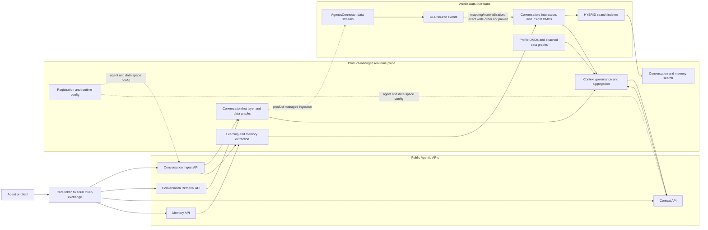
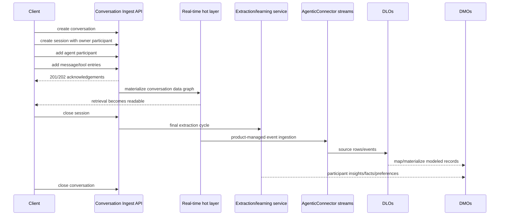
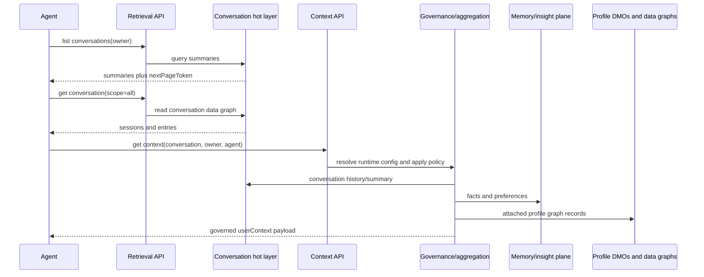
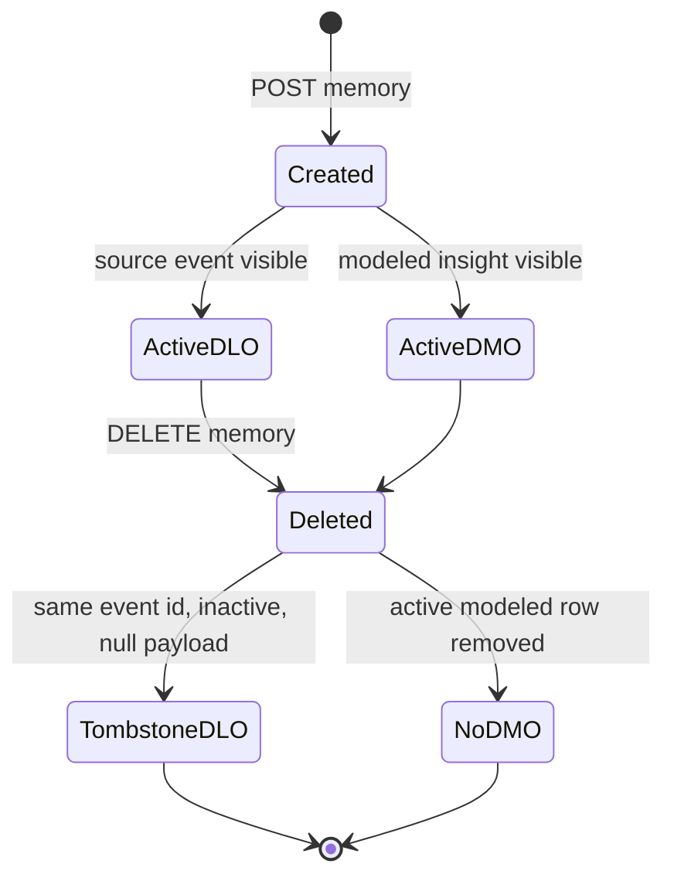
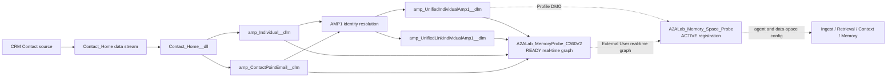

# Agentic Memory, Conversation, and Context API stack readout

Last updated: 2026-11-11  
Scope: Salesforce public Agentic Memory and Context APIs plus controlled observations in the
A2A Lab Data 360 tenant.

## How to read this document

- **Public contract** means the Salesforce developer documentation states the behavior.
- **Tenant observation** means a controlled request or Data 360 query measured it in this tenant.
- **Inferred/internal evidence** names a component visible in service traces, source/design evidence,
  or provisioned metadata, but not promised as a public API implementation detail.

These labels matter. Data 360 exposes durable objects and indexes, but the public APIs also use a
real-time layer that is not equivalent to querying a DLO or DMO. The diagrams deliberately do not
turn a plausible implementation sequence into an unsupported guarantee.

## Executive map



ASCII fallback:

```text
agent/client -> token exchange -> Ingest --------> conversation hot layer ----> Retrieval
                                  |                         |
                                  |                         +--> Data 360 streams -> DLOs -> DMOs
                                  +--> extraction/learning --------------------------^       |
Memory CRUD --------------------------> participant-insight memory ------------------+       |
                                                                                             +-> indexes/search
attached profile DMOs/data graphs --------------------------------------------------------------+
conversation + memories + profile ------------------------------------------------> Context aggregator -> Get Context
registration/runtime config selects agent, governance, graphs, and data-space routing around these paths
```

Solid arrows are public calls or directly observed data relationships. Dotted arrows are
product-managed relationships whose exact ordering is not a public contract.

## Public API surface: 14 operations

| Family | Operation | Method and path | Required scope/routing in the public contract | What it reads or changes |
| --- | --- | --- | --- | --- |
| Ingest | Create conversation | `POST /api/v1/agentic/conversations` | `agent_id`; owner id/type in body | Creates the highest-level conversation container. |
| Ingest | Create session | `POST /conversations/{conversationId}/sessions` | `agent_id`; owner plus at least one participant | Creates a continuous interaction/handoff within the conversation. |
| Ingest | Add participants | `POST /conversations/{cid}/sessions/{sid}/participants` | `agent_id` | Adds individual, employee, or agent participants. |
| Ingest | Add entries | `POST /conversations/{cid}/entries` | `agent_id`; `sessionId`; participant for each entry | Adds messages, reasoning, tool calls, or tool results. |
| Ingest | Close session | `POST /conversations/{cid}/sessions/{sid}/close` | `agent_id` | Closes the interaction and triggers the final extraction cycle. |
| Ingest | Close conversation | `POST /conversations/{cid}/close` | `agent_id` | Closes remaining sessions and the conversation. |
| Retrieval | List conversations | `GET /api/v1/agentic/conversations` | `agent_id`; `owner_id`, `owner_type` | Returns summaries, filters, and pagination, not the full graph. |
| Retrieval | List sessions | `GET /conversations/{cid}/sessions` | `agent_id`; `owner_id`, `owner_type` | Returns session summaries for one conversation. |
| Retrieval | Get conversation data graph | `GET /conversations/{cid}` | `agent_id`; `owner_id`; optional `scope` | Returns conversation, sessions, participants/entries, and page metadata from the hot layer. |
| Context | Get context | `GET /api/v1/agentic/context` | `agent_id` and `conversation_id` query; `ctx-agent-id` and `ctx-dataspace-ds_name` headers | Aggregates governed Conversation, Profile, and memory context for an LLM payload. |
| Memory | Create memory | `POST /api/v1/agentic/memory` | profile id/type/category; agent optional for client calls | Creates an explicit fact/preference memory. |
| Memory | Read memories | `GET /api/v1/agentic/memory` | profile id/type/category; agent optional for client calls | Lists governed memories in the selected category. |
| Memory | Update memories | `POST /api/v1/agentic/memory` with `memoryId` per body item | same identity/governance boundary | Replaces each memory internally, generating a new id and deactivating the previous record. |
| Memory | Delete memories | `DELETE /api/v1/agentic/memory` with `memoryId` per body item | same identity/governance boundary | Permanently removes the active memories from the API surface. |

The JWT base is `/api/v1/agentic`; the published mTLS base is
`/server/api/v1/agentic`. Retrieval also documents `/personalization/v1/agentic` as an alias.
Memory's mTLS contract uses `x-sfdc-cdp-tenant-id` and, when `agent_id` is absent,
`x-sfdc-dataspace`. Context has its own explicit data-space header. In this repository's JWT
path, the a360 token is exchanged with the registered agent and receives a data-space attribute;
the lab additionally sends the API-specific headers rather than assuming every service resolves
the attribute identically.

## Conversation ingest: accepted event to durable model



ASCII fallback:

```text
create conversation -> create session -> participants -> entries -> close session -> close conversation
          201/202 acknowledgements  |                     |
                                    v                     +-> final extraction cycle
                         real-time conversation graph
                                    |
                                    +-> AgenticConnector streams -> DLO events -> modeled DMOs
```

The public hierarchy is Conversation → Sessions → Participants and Entries. A 2xx is an accepted
write, not proof of persistence: AM-API-001 has produced fully acknowledged sequences whose
conversation remained 404. The maintained probe therefore follows ingest with all three retrieval
reads and records the response bodies.

## Retrieval and Context are related, not interchangeable



ASCII fallback:

```text
Retrieval API -> hot conversation layer -> summaries / sessions / raw entries

Context API -> runtime config + governance
            -> conversation history
            -> explicit/extracted memory
            -> attached profile data graphs
            -> one governed userContext payload
```

Retrieval is the evidence path for what the conversation store holds. Get Context is the
prompt-assembly path: it can reorder, omit, or govern sources and returns source types such as
`Conversation` and `Profile`. The tenant has served attached real-time data-graph profile rows
through Context even when semantic search indexes were empty, which is direct evidence that
Context is not simply a wrapper around HYBRID search.

## Memory CRUD lifecycle in Data 360



ASCII fallback:

```text
POST memory -> API memoryId
            -> DLO eventId = memoryId, active, payload present
            -> AiParticipantInsight DMO Id = memoryId, active, payload present

DELETE memory -> Memory API: absent
              -> DMO: row removed
              -> DLO: retained inactive tombstone, same eventId, payload null
```

This lifecycle is a tenant observation from two controlled 2026-11-11 runs. Timestamps in the
DLO and DMO differed by 1 ms, so the evidence does **not** prove DLO-first versus dual-write.
Query visibility was observed on the first DMO check 89 seconds after create, an upper bound rather
than a measured propagation SLA.

## Data 360 components provisioned behind the APIs

The agentic setup exposes nine `AgenticConnector_*` objects. Their physical DLO names contain a
tenant-specific suffix; their modeled targets are stable enough to map by object and fields.

| Logical object | Product role | Modeled DMO |
| --- | --- | --- |
| `Conversation` | Highest-level owner conversation | `ssot__Conversation__dlm` |
| `AiAgentSession` | Continuous interaction/handoff | `ssot__AiAgentSession__dlm` |
| `AiAgentSessionParticipant` | Owner/agent/employee participation | `ssot__AiAgentSessionParticipant__dlm` |
| `AiAgentInteraction` | Turn/interaction envelope | `ssot__AiAgentInteraction__dlm` |
| `AiAgentInteractionMessage` | User/agent message content | `ssot__AiAgentInteractionMessage__dlm` |
| `AiAgentInteractionStep` | Reasoning/tool execution steps | `ssot__AiAgentInteractionStep__dlm` |
| `AiAgentMessageAttachment` | Message attachment metadata | `AiAgentMessageAttachment_std__dlm` (space-prefixed in the custom space) |
| `AiParticipantInsight` | Explicit or extracted facts/preferences | `AiParticipantInsight_std__dlm` |
| `Individual` | Shared profile identity anchor | shared `ssot__Individual__dlm` |

Two provisioned HYBRID indexes are visible:

| Index | Source | Observed configuration/state |
| --- | --- | --- |
| AI Agent Interaction Message | `ssot__AiAgentInteractionMessage__dlm.ssot__ContentText__c` | multilingual-e5-large, 1024 dimensions, 512-token chunks, HNSW/cosine; READY but zero chunks in the measured tenant |
| AI Participant Insight | `AiParticipantInsight_std__dlm.InsightPayloadTxt__c` | e5_large_v2, same dimensions/chunk/HNSW shape; READY but zero chunks in the measured tenant |

DLO counts are not a reliable proxy for the real-time store: several stream DLOs were empty or
far smaller than their DMOs while Retrieval returned conversation records. Use Retrieval for hot
conversation truth, the Memory API for governed curated-memory truth, and DLO/DMO queries for
storage and lifecycle evidence.

## Product-managed or hidden components

| Component | Visibility | Role indicated by evidence | Confidence / limit |
| --- | --- | --- | --- |
| Conversation hot layer / conversation Data Graph | Named by the public Retrieval docs | Real-time storage read by list/get retrieval | High; physical implementation is not public. |
| Runtime registration/config cache | Connect API exposes part of the registration; internal evidence names a collector/cache | Resolves agent registration, profile DMOs, data graphs, and feature gates | High that it exists; cache topology and invalidation are not public. |
| Context governance/aggregation service | Public Context behavior; service evidence | Combines conversation, memory, and profile sources into governed LLM context | High role, unpublished internals. |
| Extraction/learning service | Close-session contract plus internal service evidence | Generates participant insights/facts/preferences after a final extraction cycle | High role; model, queueing, and SLA are not public. |
| Conversation/Memory search handlers | Search endpoints and internal handler names | Query the two provisioned HYBRID indexes | Medium-high; not part of the four documented API families requested here. |
| Unified-profile data-graph resolver | Attached graph behavior plus internal design/code evidence | Resolves profile graph records by owner lookup id | Medium-high; unpublished `unifiedProfileDGs` cannot be configured through the public Connect schema. |
| Feature gates and tenant config | Observed capability differences and internal evidence | Enable runtime config cache, extraction, index writes, and other staged behavior | High that gates exist; current values are not externally visible. |

Internal names observed in the investigation include `cdp-realtime-service`,
`cdp-realtime-learning-service`, an agent runtime configuration collector/cache, and the
Personalization/Get Context service. They are diagnostic leads, not dependencies callers should
couple to.

## Non-default data-space probe

Authorized test space:



ASCII fallback:

```text
CRM Contact -> Contact_Home stream -> Contact_Home DLO
                                      |-> amp_Individual DMO ---------+
                                      +-> amp_ContactPointEmail DMO --+-> AMP1 identity resolution
                                                                          |-> Unified Individual DMO
                                                                          +-> Unified Link DMO

Unified + link + source Individual + email -> READY real-time customer graph
Unified Profile DMO + customer graph + extraction=true -> ACTIVE agent registration -> four API families
```

This dependency chain is important: Agentic setup created the conversation/memory plumbing and
the custom Individual DMO, but it did not create the Contact Point Email mapping, identity
resolution, Unified Individual, or customer profile graph. Those were separate Data 360
harmonization steps required to reproduce the working registration rather than merely reproduce
its agentic setup.

| Item | Value / result |
| --- | --- |
| Data space | `A2ALabMemoryProbe` (`amp`), id suffix omitted from this report |
| Data-space state | ACTIVE |
| Agentic setup | created 16:20:07Z; ACTIVE at 16:27:24Z (7m17s) |
| Registration | `A2ALab_Memory_Space_Probe`, ACTIVE at creation 16:29:12Z |
| Profile source mapping | `Contact_Home__dll` mapped to `amp_ContactPointEmail__dlm`, matching the working default mapping shape |
| Identity resolution | `AMP1`, published; last job SUCCESS at 17:18:11Z; 146 source/known/total profiles |
| Unified Profile DMO | `amp_UnifiedIndividualAmp1__dlm` |
| Customer real-time graph | `A2ALab_MemoryProbe_C360V2`, READY; root = `amp_UnifiedIndividualAmp1__dlm`; day-zero mapping and transform present |
| Qualifier correction | Custom Contact Point Email maps `KQ_Id1__c`/`KQ_PartyId1__c`, not the default DMO's unsuffixed names. Correcting the graph withdrew AM-D360-001 and is tracked as AM-TEST-002. |
| Final registration configuration | Profile DMO attached, READY customer graph attached, automatic memory extraction enabled; Employee graph unset. API readback matches the working shape. |
| Setup list selector | Both `dataSpaceName` and `dataspaceName` query forms were ignored and returned `default` (AM-API-003) |
| Visible members after setup | 17 ACTIVE: nine filtered AgenticConnector DLO memberships, four prefixed chunk/index DLOs, and Contact/Lead/User/static-currency sources |
| Client correction | Session participant `orgId` is now omitted. The leaf docs define it as an optional Salesforce organization id for cross-org handoffs, not a data-space selector; the lab previously hard-coded `default`. |
| Ingest result after complete profile setup | All six operations succeeded first-attempt: 201/201/202/202/202/202 |
| Retrieval result after complete profile setup | List conversations returned 200 with `[]`; list sessions and get conversation returned 404. The accepted conversation was not persisted. |
| Context result after profile correction | Synthetic owner and real CRM Contact owner both returned 500 `Failed to load agent configuration`; the real-owner failure repeated with every graph detached |
| Memory result after profile correction | Create fact returned 400 `[AgenticMemory] Failed to create agentic memory` at 17:24Z and again graph-detached at 17:40Z; no record was created, so custom-space read/update/delete were not applicable |

### Paired default/custom control after final correction

The 17:52–18:05Z pass used the same repository clients, request bodies, retry counts, waits, and
API sequence. Only data space, registration, and controlled owner label differed.

| Test | `default` / `A2ALab_Memory_Case` | `A2ALabMemoryProbe` / `A2ALab_Memory_Space_Probe` |
| --- | --- | --- |
| Create/read/delete saved fact | Created; visible through creating registration after 16.5 s; deleted and immediately absent | Create returned 400 `[AgenticMemory] Failed to create agentic memory`, including a post-convergence repeat at 18:05Z |
| Create/read/delete saved preference | Created; visible through creating registration immediately; deleted and immediately absent | Create returned the same 400 |
| Conversation create/session/participant/entries/close | 201/201/202/202/202 | 201/201/202/202/202 |
| List conversations | 200 with the newly created conversation | 200 with an empty list |
| List sessions | 200 | 404 `Conversation not found` |
| Get conversation graph | 200 with closed session and entries | 404 `Conversation not found` |
| Get Context for the synthetic conversation | 200 twice with a Conversation summary | 500 twice `Failed to load agent configuration` |
| Get Context for the same real CRM customer | 200 twice; Profile and Conversation context present | 500 `Failed to load agent configuration` |
| Cleanup | Explicit fact/preference memories deleted; conversation closed | No explicit memory id was created; accepted conversation close returned 202 |

The configuration comparison was also paired:

- both registrations are ACTIVE, use their ruleset-specific Unified Individual as Profile DMO,
  attach one READY real-time customer graph, and have extraction enabled;
- AM01 and AMP1 are PUBLISHED/SUCCESS and each reports 146 source and unified profiles;
- both graphs have day-zero mapping/transform artifacts after the custom qualifier correction;
- the shared `Contact_Home__dll` maps 19 fields to default Individual and 21 to the generated
  custom Individual; both Contact Point Email mappings have nine fields and the same semantics;
- the default graph additionally contains `A2ALab_POS_Order__dlm`; the custom graph intentionally
  stops at Contact Point Email because the POS stream/DMO is not provisioned in that test space;
- the custom physical names are `amp_`-prefixed, and its Contact Point Email DMO uses the mapped
  `KQ_Id1__c`/`KQ_PartyId1__c` qualifiers rather than the default DMO's unsuffixed fields.

The setup created substantially more than the UI-level objects expose. Custom-space metadata
contains prefixed Conversation, Session, SessionParticipant, Interaction, InteractionMessage,
InteractionStep, MessageAttachment, ParticipantInsight, Individual, and User DMOs; two READY
HYBRID indexes; and two generated real-time graphs: `AgenticConversation` and
`AgenticUser`. Those graphs add ID/VALUE DMOs, a data-graph state table, and 13 fragment/state
DMOs. The shared physical AgenticConnector DLO memberships apply filters such as
`dataspace__c = A2ALabMemoryProbe`, while modeled/search artifacts use the `amp_` prefix. This is
the clearest measured answer to what setup hides behind the product surface.

The initial runtime conclusion was premature because the custom registration had no Profile DMO.
The corrected setup mirrors the working default registration through mapped Individual and Contact
Point Email data, successful identity resolution, Unified Individual, Profile DMO attachment,
automatic extraction, and a READY real-time graph with day-zero artifacts. The first graphs used
the wrong custom qualifier fields; that test error is AM-TEST-002 and AM-D360-001 is withdrawn.

Provisioning and complete profile configuration still did not imply runtime correctness. The
paired run completed the full Ingest lifecycle, but exposed AM-API-012: the accepted
conversation was absent from Retrieval, Context could not load the agent configuration, and
explicit Memory create failed. Those failures persisted after the corrected graph was READY and
attached. The custom space and registration remain isolated for product
diagnosis; no memory record requires cleanup. The readout maps Memory read/update/delete from the
public contract and default-space CRUD evidence, but they could not be called meaningfully in the
custom space because create never produced a `memoryId`.

## Known defects and contract mismatches

The maintained ledger is
`build-notes/ws27/agentic-memory-product-api-defects.md`. It currently tracks acknowledged-but-
missing ingest, setup selector/schema inconsistencies, Memory governance and cross-agent mismatch,
unsafe partial PATCH semantics, stale search indexes, and data-space routing ambiguity.

## Public documentation used

- [Agentic Memory and Context API reference home](https://developer.salesforce.com/docs/data/agentic-memory-context/references/agentic-memory-context-api-ref/agentic-memory-context-ref-home.html)
- [Conversation Ingest APIs](https://developer.salesforce.com/docs/data/agentic-memory-context/references/agentic-memory-context-api-ref/agentic-memory-api-conversation-ingest-apis.html)
- [Conversation Retrieval APIs](https://developer.salesforce.com/docs/data/agentic-memory-context/references/agentic-memory-context-api-ref/agentic-memory-api-conversation-retrieval-apis.html)
- [Context API](https://developer.salesforce.com/docs/data/agentic-memory-context/references/agentic-memory-context-api-ref/agentic-memory-api-context-api.html)
- [Memory APIs](https://developer.salesforce.com/docs/data/agentic-memory-context/references/agentic-memory-context-api-ref/agentic-memory-api-memory-apis.html)
- [Create Session](https://developer.salesforce.com/docs/data/agentic-memory-context/references/agentic-memory-context-api-ref/agentic-memory-api-create-session.html)
- [Add Participants](https://developer.salesforce.com/docs/data/agentic-memory-context/references/agentic-memory-context-api-ref/agentic-memory-api-add-participants.html)
- [Update Memories](https://developer.salesforce.com/docs/data/agentic-memory-context/references/agentic-memory-context-api-ref/agentic-memory-api-update-memories.html)
- [Delete Memories](https://developer.salesforce.com/docs/data/agentic-memory-context/references/agentic-memory-context-api-ref/agentic-memory-api-delete-memories.html)

The public docs define caller-visible contracts. Tenant observations come from
`plan/03-results.md`; reproducible setup and probes live in `scripts/setup_agentic_memory.py` and
`scripts/memory_governance_probe.py`.
