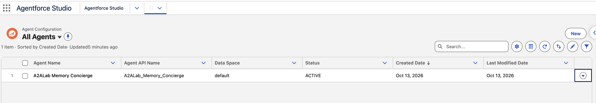
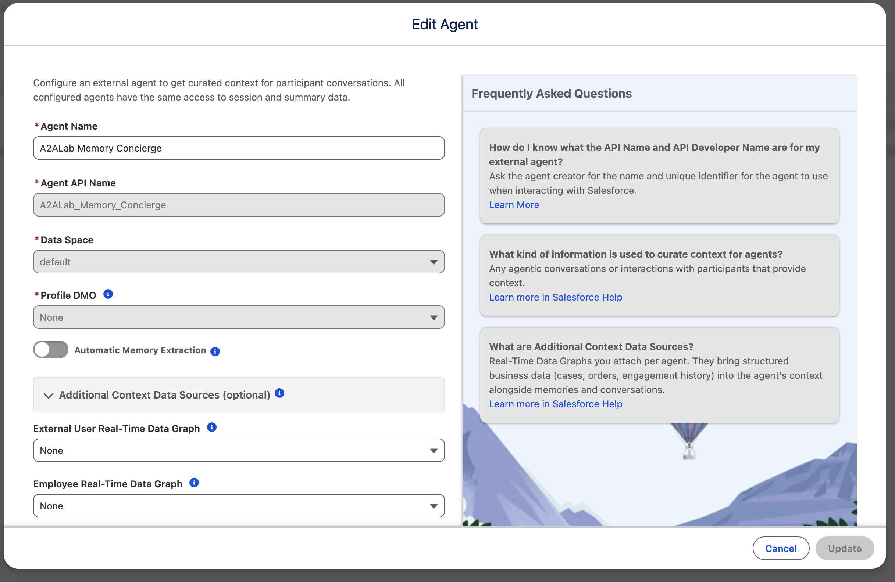
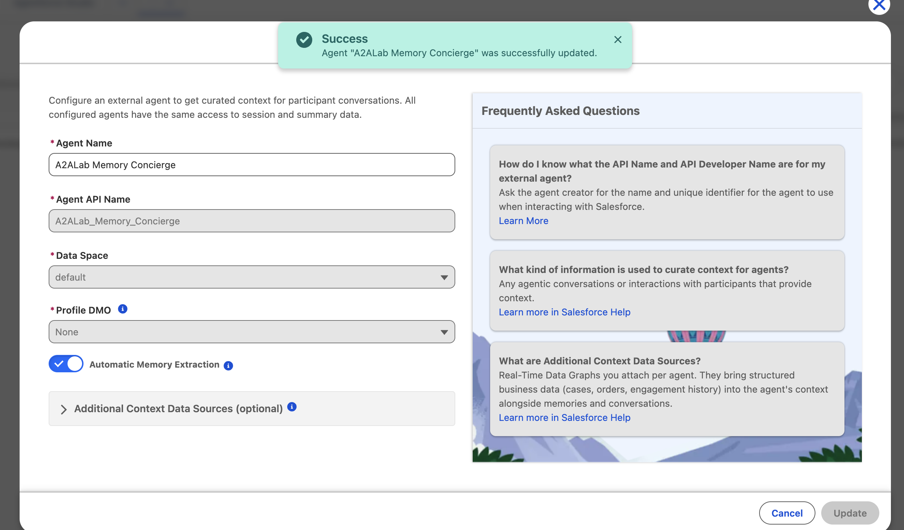

# 18 — Data 360 Agentic Memory and Context: one memory, every platform

**Status: Phase 0 + Phase 1 DONE (2026-10-12): the memory ECA is deployed and verified; the `default` agentic setup is ACTIVE and `A2ALab_Memory_Concierge` is registered (ACTIVE). Phase 2 (D83) is DEPLOYED (2026-10-13): bridge task definition :13, `A2ALabMemoryTurn` (6/6 tests, 100% coverage) and concierge v1 active. The tenant smoke passed (2026-10-13), and **first recall across sessions passed (2026-10-14)**. The reply side was measured on 2026-10-15: replies never reach memory natively. D87's idempotent entry ids are live; its reply path is not: `last_reply` turned out to be voice barge-in state, so concierge v2 failed every turn and v1 is active again, and the reply moves out of band (D89). Phase 0b (D86, 2026-10-14) moves the memory ECA off the admin onto a dedicated API-only integration user: built, with the production steps pending. Agentforce also has NATIVE memory actions (`manageUserMemory` and friends), so Phase 2b (D84) runs both routes as an experiment, including a Data Cloud One companion-org arm.** This
doc is the setup path and the experiment design. Decisions get ADRs in
`plan/00-decisions.md` as they settle, and a `## WS27` delivery record in
`plan/07-workstreams.md` once a build starts.

## What it is, and why this lab in particular

Agentic Memory and Context (Data 360, **Limited GA** — free during Limited GA,
final pricing unannounced) gives an agent persistent cross-session memory:

- conversations are **ingested** turn by turn (messages *and* traces: tool calls,
parameters, results);
- Data 360 **extracts** facts, preferences and session summaries with an LLM
(the only part that will consume flex credits);
- a **GetContext** call returns an LLM-ready context pack for a conversation
owner, assembled from profile memory, conversation history and any extra
real-time data graphs the agent is associated with.

Every agent in one **data space** shares the same profile unification. The docs
pitch this as preventing "agent amnesia during handovers between agents." That is
exactly the lab's subject. The lab already pairs Agentforce with Claude, OpenAI,
ADK, Foundry, Strands and LangGraph agents, and this feature claims one memory
across all of them. The question this doc sets up:

> **If a user tells an agent on platform A something, does an agent on platform B
> know it on the next session, and how does the integration effort differ by
> platform (native SDK adapter, plain REST, Apex action, Agentforce native
> memory action)?**

That is the same "same scenario, compare the seams" shape as the protocol matrix
(`plan/02-matrix.md`), applied to memory instead of transport.

### Sources

- Public guide: `developer.salesforce.com/docs/data/agentic-memory-context/guide/`
(registration, conversation management, memory management, context, profile
unification, billing, fast mode, governance).
- Public API reference (the "offcore" runtime APIs):
`.../agentic-memory-context/references/agentic-memory-context-api-ref/`.
- Connect API "Agent Configuration" tag (registration). The page is JS-rendered,
so the exact paths are **not yet captured** (see Phase 1).
- Internal "Agent Memory | Agent Builder Setup Guide" (Google Doc) and the SDK
repo `git.soma.salesforce.com/a360/cdp-agentic-ingestion-sdk` (package
`agentic-context` 0.6.0, Python ≥3.10). Both are internal. Cite them as
provenance and don't vendor their content.


## What the org already has (probed read-only, 2026-10-12)


| Fact                                            | Evidence                                                                                                                                   | Consequence                                                                                                                                                     |
| ----------------------------------------------- | ------------------------------------------------------------------------------------------------------------------------------------------ | --------------------------------------------------------------------------------------------------------------------------------------------------------------- |
| The feature is provisioned in the org           | Standard sObjects `DataAgenticContext` (key `1lc`) and `DataAgenticContextAgent` (key `1lW`) exist; both createable/deletable; 0 rows each | Nothing registered yet; first registration also creates the agentic setup                                                                                       |
| The UI "Agent Config" exists but stayed hidden until setup | Tabs `standard-Agents` ("Agent Config") and `standard-DataAgenticContextAgent` ("Data Agentic Context Agents", the raw object tab) exist. "Agent Config" became usable once the `default` setup went ACTIVE (Phase 1) | App Launcher → **"Agent Config"** (Agentforce Studio → Agent Configuration). The object tab errors (Phase 1); registration needs neither |
| One data space                                  | `DataSpace`: `default` only                                                                                                                | Every lab agent lands in `default`; no data-space choice to make                                                                                                |
| No Identity Resolution rulesets                 | `GET /ssot/identity-resolutions` → 0                                                                                                       | The **Profile DMO** field won't appear at registration ("Data 360 handles this"). Note the Profile DMO choice is per data space and **cannot be changed later** |
| Data 360 tenant region                          | eu-central-1 tenant (D70)                                                                                                                  | GetContext latency from us-east-1 agents includes a transatlantic hop. Record it, don't hide it                                                                 |


`DataAgenticContext` fields: `Name`, `DataSpaceId` → DataSpace, `IsEnabled`,
`DataAgenticContextDefStatus` (ACTIVE / PROCESSING / ERROR).

`DataAgenticContextAgent` fields: `Name`, `AgentApiName` (req),
`DataAgenticContextId` (req), `AgentLabel`, `ProfileObjectList`,
`DataAgntcCntxtAddlDgLst` (additional data graphs), `MemoryCategoryList`,
`IsMemoryGenerationEnabled` (req), `Status` (ACTIVE / PROCESSING / ERROR).

## The runtime surface (what every platform calls)

All runtime calls go to the **Data 360 tenant endpoint**, not the core org. Auth
is a CDP bearer token from a two-leg exchange: a JWT-bearer grant against
`/services/oauth2/token` yields a core token, and `POST {instance}/services/a360/token`
exchanges it for a tenant token plus the tenant base URL. The SDK's `ContextAuth`
/ `BeaconAuth` does both legs and refreshes. Headers: `Authorization: Bearer …`,
plus `agent_id: <AgentApiName>`.


| Call                         | Method + path                                                                                                              |
| ---------------------------- | -------------------------------------------------------------------------------------------------------------------------- |
| Create conversation          | `POST /api/v1/agentic/conversations` (`conversationId`, `conversationOwnerId`, `ownerType` individual|employee, `channel`) |
| Create session               | `POST /api/v1/agentic/conversations/{id}/sessions`                                                                         |
| Add participants             | `POST …/sessions/{sid}/participants`                                                                                       |
| Ingest turn                  | `POST /api/v1/agentic/conversations/{id}/entries` (`sessionId`, `entries[]` of `category` Message|Trace) → 202             |
| Close session / conversation | `POST …/sessions/{sid}/close`, `POST …/{id}/close`                                                                         |
| Get context                  | `GET /api/v1/agentic/context?agent_id&conversation_id&owner_id&owner_type[&mode=fast&token_budget]`                        |
| Memories CRUD                | `/api/v1/agentic/memory` (create/read/update/delete)                                                                       |


Limits (SDK `docs/API_LIMITS.md`): 200 KB per request, 250 req/s, and **~30 s
data-availability lag after ingestion**. A recall test must wait out the lag
before calling GetContext, or it measures the lag, not the memory.

## Phases


### Phase 0 — prerequisites (headless unless noted)

**Done 2026-10-12, fully headless:**

- Data Cloud Architect: already held by the operator admin (the sf CLI user).
- `a2a_lab_memory` ECA deployed by `scripts/setup_jwt_eca.py create memory` (a
generic JWT-bearer ECA builder; `memory` is its first preset). The four F6
files are rendered from `.env` into a scratch project, so nothing
org-specific is committed. Check-only `--validate` passed first.
- `verify memory` proved both legs: JWT bearer → core token with all three
`cdp_*` scopes, then `/services/a360/token` → tenant token (`expires_in`
≈ 8 h). Added to `identity_preflight.py` (six of six green).
- **Measured, not in the guide:** JWT bearer also needs the `RefreshToken`
scope. Without it the grant 400s "refresh_token scope is required and the
connected app should be installed and preauthorized."
- Still the operator's: `env_sync.py push` (D39), and `chezmoi add --encrypt .a2alab/memory_jwt_private.pem` (D45).

The original Phase 0 checklist:

1. **Permission:** the operator user holds the *Data Cloud Architect* permission
  set (check with `PermissionSetAssignment` SOQL; assign via the DX MCP
   `assign_permission_set` if missing).
2. **Memory ECA** `a2a_lab_memory`: JWT-bearer, cert-based, scopes `api
  cdp_ingest_api cdp_profile_api cdp_query_api`, admin-pre-authorized. Build it  from metadata with the F6 ECA runbook (`plan/04-runbooks.md`§"To add  another"), not Setup. JWT bearer needs no consumer secret, so there is no  irreducible UI step. The private key goes under`.a2alab/`and needs a  one-time`chezmoi add --encrypt`(D45). The consumer key and run-as user go  in`.env `(`env_sync.py push`, D39).
3. **One identity mint:** a lab-side `interop.memory` auth helper that does the
  two-leg exchange once (mirrors the SDK's `ContextAuth`) so Python platforms
   that don't use an SDK adapter share it. Add it to `identity_preflight.py`
   (D37/F6) so a broken memory credential fails the preflight, not a demo.


### Phase 0b — a dedicated integration user (D86)

**Status (2026-10-14): user created and the ECA moved onto it. `verify`, `probe`
and the preflight are green as the new user, and the admin's `PersonalizationUser`
grant is gone. The bridge was redeployed (task definition `:17`) and now mints as the
integration user. The concierge recalled the 2026-10-14 persona, whose memory the admin wrote, through it.**
Measured: Context Service Admin is refused by the Integration license and is not
needed (`plan/03-results.md`). Phase 0 put the admin in charge of the memory ECA: it was the
JWT `sub`, and the policy pre-authorized the System Administrator profile. So
the bridge's secret (D83) held an org-admin credential with the `api` scope.
D86 moves the app to a user that can do nothing except memory:

| Piece | What | Where |
|---|---|---|
| User | `a2alab.memory@<org domain>`: **Salesforce Integration** license, **Minimum Access - API Only Integrations** profile (no UI login, no object access) | `setup_agentic_memory.py user` |
| Capabilities | Data Cloud User (`GenieUserEnhancedSecurity`) and Context Service Runtime, each with its permission-set license. Context Service Admin is refused by the Integration license and measured unneeded | the same verb (`USER_BUNDLE`) |
| Gate | `A2ALab_Memory_Integration`: an empty permission set that the ECA policy pre-authorizes **instead of the admin profile** | `salesforce/…/permissionsets/`, `Preset.preauth_permission_set` |
| Guards | `create` refuses an admin run-as for a gated preset; `identity_preflight.py` FAILs when the minted token belongs to an admin | `setup_jwt_eca.py`, `identity_preflight.py` |

The recipe is `plan/04-runbooks.md` §11, "Memory integration user". In order:
deploy the gate, then `user --apply`, then `create memory` (validate first),
then verify, probe and preflight, then a bridge config redeploy, and finally
`ungrant --apply` to remove the 2026-10-13 `PersonalizationUser` red herring
from the admin.

**What to measure on the way (each is open until it runs):**

1. Whether an Integration-license user can hold the Data Cloud User and Context
   Service permission-set licenses at all. `user --apply` answers this, and a
   refusal names the license.
2. Whether the new user reaches the `default` data space and the concierge's
   registration, which the admin created. `probe concierge` answers this.
3. Whether memory the admin-run app wrote is readable by the new user. Re-read the
   2026-10-14 recall owner (`plan/03-results.md`).
4. The minimum bundle. Remove `ContextServiceAdmin` and re-probe (plan/18
   assumed the writes need it; nothing measured that). Then drop the `Api`
   scope and re-verify, because the a360 exchange only ever carries the three
   `cdp_*` scopes.
   **Both measured.** Context Service Admin is refused by the Integration license
   and isn't needed (2026-10-14). `Api` is needed (2026-10-15): without it the
   a360 exchange rejects the core token as an "invalid subject token", even
   though the tenant token never carries `api` (`plan/03-results.md`).

**Done separately (D90):** the six client-credentials ECAs, which also ran as the
admin (D86 Consequences), now run as four integration users of the same shape, each
with a separately measured bundle.


### Phase 1 — registration (Agentforce agent first)

**Captured 2026-10-12** from the published spec (the reference page fetches
`/static/datacloud/connectapi/spec/cdp-connect-api-Swagger.yaml`; a plain curl
gets a 404 page, an in-browser fetch gets the 3 MB YAML). All are API **v66.0+**
under `/services/data/v66.0`:


| Call               | Method + path                                                                                                                                                  | Probed                                                 |
| ------------------ | -------------------------------------------------------------------------------------------------------------------------------------------------------------- | ------------------------------------------------------ |
| List agents        | `GET /ssot/agentic/agents`                                                                                                                                     | `{"agents": [], "totalSize": 0}`                       |
| Register agent     | `POST /ssot/agentic/agent` — `{dataspaceName, name, label, description, configuration: {profileDmos[], contextDataSources: {dataGraphs[]}}}`; 409 = name taken. **Note the lowercase `s`**: the schema says `dataSpaceName`, the server says `JSON_PARSER_ERROR Unrecognized field "dataSpaceName"`. The example is right; the setup endpoint is the reverse | sent 2026-10-12 → ACTIVE                                           |
| Get / delete agent | `GET` / `DELETE /ssot/agentic/agent/{idOrApiName}`                                                                                                             | —                                                      |
| List setups        | `GET /ssot/agentic/setup` (unpublished path; schemas + examples are in the spec)                                                                               | `{"setupConfigs": [], "totalSize": 0}`                 |
| One setup          | `/ssot/agentic/setups/{name}` (create presumed `POST /ssot/agentic/setups` `{dataSpaceName, enabled}`)                                                         | `INVALID_API_INPUT "Given setup Name does not exists"` |


The returned agent id has key prefix `1lW`, so a Connect API registration
*is* a `DataAgenticContextAgent` row, with provisioning around it. That makes
the raw sObject insert (option 2) strictly worse. **Script:**
`scripts/setup_agentic_memory.py` (`status`, `setup`, `register <agent>`,
`wait <agent>`), which defaults to a dry run that prints the exact request.

**Run order** (`set -a; source .env; set +a` first; `PYTHONPATH=scripts`):

1. **Agentic setup for the data space — DONE 2026-10-12.**
   `uv run python scripts/setup_agentic_memory.py setup --apply` sent
   `POST /ssot/agentic/setups` `{"dataSpaceName": "default", "enabled": true}`
   (the presumed create path was right). It returned a setup record (key
   prefix `1la`, i.e. a `DataAgenticContext` row) in `PROCESSING`, which
   went **ACTIVE after ~6 m 45 s**. No profile DMO is given: `default` has no
   identity-resolution ruleset, and that is deliberate. A unified-profile
   experiment would get its own data space, since the profile DMO choice is
   fixed per data space.
2. **Register the agent — DONE 2026-10-12.** `register concierge --apply` sent
   `POST /ssot/agentic/agent` for `A2ALab_Memory_Concierge` (label "A2ALab
   Memory Concierge", data space `default`, no `configuration`). It returned a
   `1lW` id with status **ACTIVE immediately**, so the provisioning cost sits in
   the setup step, not per agent. The first attempt 400'd on the field casing
   (table above) and created nothing.
3. **Credential bound to the agent — verified.** `setup_jwt_eca.py verify
   memory --agent-id A2ALab_Memory_Concierge` passes both legs. Before
   registration, a360 refused that `aid` with `access_denied`, so this is the
   proof that the registration is what the runtime APIs check.

**What the setup provisioned** (read-only inventory, 2026-10-12): eight
ingestion data streams, all ACTIVE, named `AgenticConnector_<object>_<hash>`
for `AiAgentSession`, `AiAgentSessionParticipant`, `AiAgentInteraction`,
`AiAgentInteractionStep`, `AiAgentInteractionMessage`, `AiParticipantInsight`,
`Conversation` and `Individual`, plus `AgenticConversation_*`,
`AgenticIndividual_*` and `AgenticUser_*` ID/VALUE DMOs. Still unconfirmed:
the session and profile data graphs. `GET /ssot/data-graphs` returned an
error list, not a collection.

#### What the UI shows (screenshots, 2026-10-12)

Screenshots for this plan live in `plan/images/18-*.png`, added as they are
taken. The UI is the read-back check on what the API did, not the build path.

The **Agent Config** tab appeared once the setup was ACTIVE (App Launcher →
"Agent Config", shown in the Agentforce Studio app as **Agent Configuration →
All Agents**). The API registration shows up there as one row: Agent Name,
Agent API Name, Data Space `default`, Status `ACTIVE`.



Its **Edit Agent** dialog maps onto the API fields and the
`DataAgenticContextAgent` columns:

| UI field | API body (`POST /ssot/agentic/agent`) | sObject column | Notes |
|---|---|---|---|
| Agent Name | `label` | `AgentLabel` | Editable |
| Agent API Name | `name` | `AgentApiName` | Greyed out: immutable. It is the runtime `agent_id` header |
| Data Space | `dataspaceName` | via `DataAgenticContextId` → setup | Greyed out: immutable |
| Profile DMO (required) | `configuration.profileDmos[]` | `ProfileObjectList` | Greyed out at **None**: `default` has no identity-resolution ruleset, so there is nothing to pick |
| **Automatic Memory Extraction** | `configuration.isMemoryGenerationEnabled`, returned by `GET agent` at **v67.0** only (absent at v66, and not in the v66 spec) | `IsMemoryGenerationEnabled` | Off on registration. This is the LLM extraction of facts and preferences, the part that will consume flex credits after Limited GA. **Mapping confirmed 2026-10-12:** toggled on in the UI, the column read `true` with a matching `LastModifiedDate`. Scripted as `setup_agentic_memory.py extraction <agent> on\|off [--apply]`. The first version wrote the column directly; it now writes `configuration` over v67 (see below for why). **UI → column is proven both ways** (UI on read back `true`, UI off read back `false`). **Column → UI is NOT:** after `extraction concierge on --apply` (accepted, column `true`, modified 05:38:40Z), the Edit Agent dialog opened at 05:40Z still showed the toggle **off**. So the UI either caches or reads the setting from somewhere other than this column, and a direct column write may not reach the service that runs extraction. The Connect API agent item has only GET and DELETE, so the UI's Update calls an unpublished path. The captured Update body is an `AgentInputRepresentation` with `configuration`, so the script now writes the real field over v67. **Headless write proven 2026-10-13** (script on → UI shows on, below) |

**Where the UI really writes (DevTools capture, 2026-10-12).** The Edit Agent
dialog's **Update** posts the Aura action `CdpAgentSetup.updateAgentContext`
(`/aura?…&aura.CdpAgentSetup.updateAgentContext=1`, 200). After that, a
`RecordUi.executeGraphQL` call re-reads the record. It isn't a Connect API
call, so the extraction setting goes through a server-side controller that
updates the column *and*, by the evidence above, a store the dialog reads back
from:

- A **reload and a fresh login** still showed the toggle off after the direct
  column write, so the dialog wasn't caching.
- After the UI Update at 05:49:57Z, the column reads `true` with that exact
  `LastModifiedDate`.

Conclusion: the `IsMemoryGenerationEnabled` column is a **mirror** of the
setting, not its source. A direct sObject write moves the mirror and leaves
the real setting alone. The script's `extraction --apply` is therefore not a
valid build path. Getting a headless path means replaying the Aura action's
payload (next capture: the request's Payload tab, and the response of the
`CdpAgentS…` read the dialog makes when it opens). These captures show the
org's My Domain host, so they stay out of `plan/images/`.

**The real setting is on the Connect API, from v67.0 (2026-10-13).** The
dialog opens with the Aura read `CdpAgentSetup.getAgentContext` with params
`{"agentIdOrApiName": "<AgentApiName>"}`. That is the Connect API's path
parameter name, so the controller wraps the same resource. Its `returnValue`
is the Connect API agent representation **plus**
`"configuration": {"isMemoryGenerationEnabled": true}`. The same `GET
/ssot/agentic/agent/{idOrApiName}` returns that block at **v67.0** and omits it
at v66.0. The captured spec is v66, which is why it showed no extraction field.
So extraction is readable headlessly as `configuration.isMemoryGenerationEnabled`
(v67), and `setup_agentic_memory.py extraction` now reads it there.

**The write's shape (DevTools capture of Update, 2026-10-13).** The Aura action
`CdpAgentSetup.updateAgentContext` sends these params:

```json
{"agentIdOrApiName": "A2ALab_Memory_Concierge",
 "AgentInputRepresentation": {"label": "A2ALab Memory Concierge",
                              "configuration": {"isMemoryGenerationEnabled": true}}}
```

`AgentInputRepresentation` is the Connect API's own input class, the same one
the registration `POST` takes. So the UI calls the Connect API agent update, and
the body is the subset the dialog edits: `label` is always re-sent, and
`configuration` carries the toggle. `extraction <agent> on|off --apply` sends
exactly that body as a v67 `PATCH /ssot/agentic/agent/{name}`, then checks that
the returned `configuration` holds the new value. Aura hides the HTTP method, and
the v66 spec publishes only GET and DELETE on the item, so the verb was a guess.
**PROVEN 2026-10-13, end to end:** the operator turned extraction off in the
UI, and the script read `false` for both the real field and the mirror.
`extraction concierge on --apply` then returned `true`, the mirror followed
to `true`, and the Agent Config dialog showed the toggle **on**. That is the
direction the direct column write never achieved. Extraction is now fully
headless, and the UI is no longer needed for this setting.
| Additional Context Data Sources: External User / Employee Real-Time Data Graph | `configuration.contextDataSources.dataGraphs[]` | `DataAgntcCntxtAddlDgLst` | Optional. One graph per **owner type** (`individual` vs `employee`, see Open question 3) |



**Automatic Memory Extraction turned ON for `A2ALab_Memory_Concierge`**
(operator, in the UI, 2026-10-12). After it, `SELECT IsMemoryGenerationEnabled
FROM DataAgenticContextAgent` reads `true`. `MemoryCategoryList` is still
`null`, and the dialog has no field for memory categories.



Two things the dialog says that the API reference doesn't:

- **It is built for external agents.** The dialog reads "Configure an
  external agent to get curated context for participant conversations", and
  its FAQ says to ask "the agent creator" for the API name. Registration is
  keyed by name only and never checks for a matching `BotDefinition`, which is
  why `A2ALab_Memory_Concierge` is registered while no Agentforce agent of that
  name exists yet (Phase 2 builds it, and must use exactly that developer
  name).
- **"All configured agents have the same access to session and summary
  data."** This partly answers Open question 4: session and summary data are
  shared across every agent in the data space. Whether *extracted memories*
  are shared too is still to be measured in Phase 4.2.

**The "Data Agentic Context Agents" tab errors** with `INVALID_FIELD: No such relation 'DataAgenticContextAgentDef' on entity 'DataAgenticContextAgent'`.
No such relation exists at v66–v68 (sObject describe, Tooling, zero list
views), so the object tab's page queries a schema this org doesn't have. It's
a Limited-GA platform mismatch, not something the lab configured. The UI
"Agent Config" is the `standard-Agents` tab, not this object tab.

Headless order of preference:

1. **Connect API "Agent Configuration"** — the documented path (above).
2. **sObject insert fallback:** `DataAgenticContext` (DataSpaceId = default,
  IsEnabled = true), then `DataAgenticContextAgent` (AgentApiName, AgentLabel,
   IsMemoryGenerationEnabled = true). **Unproven:** a raw insert may skip the
   provisioning the Connect API triggers (connectors, DLOs, DMOs, session and
   profile data graphs). Verify, don't assume.
3. **UI** (App Launcher → Data Agentic Context Agents → New). Only if 1–2 fail,
  naming what was ruled out.

**Done when:** `Status` goes PROCESSING → ACTIVE, and the auto-created artifacts
exist: ingestion connectors + DLOs, session/profile DMOs + mappings, one session
data graph, and two profile data graphs (Individual- and User-rooted). Inventory
them here. They are new Data 360 objects in **production**, and deleting the
agent irreversibly deletes its conversations and memories.

`AgentApiName` and data space are **immutable**, so names are decided before the
first insert (see "Which Agentforce agent" below).

### Phase 2 — Agentforce wiring (D83)

**Status (2026-10-13): deployed; the tenant smoke and first recall are next.** The design is
D83 in `plan/00-decisions.md`. In short:

- **Deterministic hooks exist; the old "no after-turn hook" premise was wrong.**
  Agent Script has `before_reasoning` and `after_reasoning` procedures that run
  on every turn, outside the planner. They can `run` an action, `set`
  variables from its outputs, branch, and transition (the Agent Script
  "After Reasoning" reference; the `salesforce/agentscript` repo `SPEC.md`
  §5). So memory doesn't depend on the model choosing to call an action.
- **No hook can bind the reply (D89, correcting D87).** `user_input` carries
  this turn's raw user text. `@system_variables.last_reply` compiles in both
  hooks, but it is voice barge-in state (`interrupted`,
  `interrupted_heard_text`), not text: bound to a String input it fails every
  turn. The reply exists only in the planner trace, so it reaches memory out
  of band (D89). Content-derived entry ids (D87) still make each hook's
  per-pass re-send of the user message a no-op.
- **One action, run from `before_reasoning`.** `A2ALab: Memory Turn`
  (`A2ALabMemoryTurn`) starts the memory conversation on the first turn,
  returns the context to read, and ingests `@system_variables.user_input`.
  The context lands in `@variables.memory_context` and is interpolated into
  the instructions. The concierge has one subagent (`start_agent concierge`,
  no transitions), so no transition can skip the hook.
- **Through the bridge, not the tenant direct.** The invocable POSTs to
  `callout:A2ALab_Bridge/memory/turn`, the Named Credential the twins
  already use (Path A, `plan/01-architecture.md`). The bridge holds the
  memory ECA identity and calls the tenant via `src/interop/memory.py`, the
  same client Phase 3's generic seam reuses. Apex never holds a tenant token,
  and the tenant leg is a traced hop (`target = agentic-memory`).
  Apex-direct would need an org-held signing cert, a second ECA (one cert
  per ECA, per-caller apps per D37), and Remote Site Settings for My Domain
  and the tenant host. It would also leave the tenant leg untraced. It stays
  available as a comparison arm, the D30 shape.
- **Fail-open.** A refused memory call returns `ok: false` and an empty
  context. The turn proceeds without memory instead of failing inside the
  action budget (`plan/03-results.md`).
- **Native `context:` flags are OFF in this version.** Agent Script's
  Agentforce dialect has a `context:` block (`memory.enabled`,
  `past_conversations.enabled`) that the org's compiler accepts. Its runtime
  effect on Data 360 memory is unmeasured. (An earlier draft said Agentforce
  had no native path and reached memory only through Apex actions. That was
  wrong: the org exposes native memory actions, see Phase 2b.) Keeping it off
  makes any recall attributable to the explicit
  path. Turning it on is the second arm, published as its own version
  (Phase 2b, D84).
- **The reply side is measured, not assumed.** The agentic setup created
  `AgenticConnector_*` data streams over `AiAgentSession`,
  `AiAgentInteraction`, `AiAgentInteractionMessage` and friends, so Agentforce
  turns may already reach Data 360 natively, replies included. Whether they
  reach *this agent's memory conversation* was measured 2026-10-15
  (`plan/03-results.md`). They don't: replies land only in the STDM DMO under
  the Agentforce session, unlinked and hours late. The Session Trace replay
  (D73) is the reply path after all: `last_reply` does not hold the reply (D89).

Owner identity: `@variables.memory_owner` is an External-visibility variable
the caller sets per persona (Agent API session variables), with default
`a2alab-persona-default`, so an unset caller never writes into a real
persona's memory. `owner_type` is `individual`, the SDK default. Open
question 3 still applies.

**The tenant precondition (2026-10-13).** `GET /api/v1/agentic/context` for a
conversation that doesn't exist returns **403 with an empty body**, for every
owner type and header variant tried. That matches the SDK's own e2e suite,
where context for an owner who isn't a participant "should return empty or
403" (TC-NEG-17). The read is only meaningful after a write.
`setup_agentic_memory.py probe concierge --apply` runs the SDK's write
lifecycle with synthetic ids (owner `a2alab-probe-owner`) and then reads it
back. It is the go/no-go for the tenant path before any deploy.

**Correction, same day: the write was not the precondition.** The probe's
writes all landed (201/201/202/202, and get conversation returned the entries),
yet GetContext still 403'd with an empty body at +15, +30, +45 and +60 s, so
it is not ingestion lag either. Read-only variants ruled out more:

- Header shape: the SDK's `ctx-dataspace-ds_name`, none (as the bugbash e2e
  sends), `x-sfdc-dataspace`, and the ingest headers all 403.
- The token: `aid`/`xid` on the a360 exchange change no claims, and the read
  still 403s.
- The agent registration: `ACTIVE`, extraction on, created by the run-as user.

Omitting `conversation_id` returns a 400 whose `instance` is
`/personalization/v1/agentic/context`, so the read passes routing and
validation and is refused by the **Personalization** service's authorization.
`GET /api/v1/agentic/memory` 403s the same way ("Access forbidden").

The run-as user holds `ContextServiceRuntime` and `ContextServiceAdmin` (which
the writes need) but not `PersonalizationPlatform`. The candidate fix is
`setup_agentic_memory.py grant [--apply]`, which assigns the Personalization
license and the `PersonalizationUser` permission set; then re-run `probe`. It
is a hypothesis until that read returns 200. (The `grant` verb has since been replaced by `user` and `ungrant`, D86.)

**Applied 2026-10-13 and ruled out.** `grant --apply` landed (the user now has
`PersonalizationPlatform`), but GetContext and the memory list still 403 with
a freshly minted token, including after a 3-minute wait. The token's `cp`
claim did not change either. The grant stays in place because it is harmless,
but the cause is still open.

**OAuth scopes ruled out too (2026-10-13).** The memory ECA was redeployed with
every remaining Data 360 scope in the ECA enum (`CDPSegment`,
`CDPIdentityResolution`, `CDPCalculatedInsight`) plus `SFApiPlatform` and
`EinsteinGPT`. The core token then carried all nine, but the a360 exchange
still issued the tenant token `scp: cdp_ingest_api cdp_profile_api
cdp_query_api` and nothing else, and every read still 403'd. The exchange
**filters** scopes to that fixed three, so no ECA scope can change what the
tenant read sees. The preset went back to the guide's set (least privilege).

**Resolved, same day: a missing header, `ctx-agent-id`.** The product's QA
fit tests on git.soma (`a360-quality/jarlsberg-fit-tests`, class
`AgenticContextApi`) send the agent's name as a `ctx-agent-id` header on every
context read. Neither the SDK nor its bugbash e2e does. With it, the same
token and the same probe conversation return **200**, with or without
`ctx-dataspace-ds_name`. The `agent_id` query parameter is not what the read
authorizes on. `interop.memory.get_context` and the `probe` verb now send it.

The first successful read shows extraction had been working all along. The
probe turn (written 17:32 UTC) had become three `userContext` entries:

- a `Conversation` summary ("Customer stated preference for aisle seats and
  indicated travel plans to Lisbon in November…")
- `SYS_PROFILE_PREFERENCES`: "The user prefers aisle seats when flying."
- `SYS_PROFILE_FACT`: "The user is flying to Lisbon in November 2026."

All three were stamped within a second of the write, so extraction is not the
slow step it was assumed to be. `render_context` flattens this shape into
`- userContext.entry: …` lines. Each `entry` is already LLM-ready text, so a
renderer keyed on `entry` would read better (WS27 follow-up).

So none of the levers above were the cause. The `PersonalizationUser` grant
and the five extra ECA scopes are unneeded: the grant can be revoked, and the
ECA goes back to the guide's scopes by re-running `setup_jwt_eca.py create
memory` (the preset already says so). Lesson for the other platforms'
adapters (Phase 3): read the QA fit tests for the wire contract, not only the
SDK.

The first hosted read was slow for a reason that had nothing to do with memory.
After the header fix (bridge task definition 15), a cold `/memory/turn` read returned
at 27.1 s, and warm reads at 0.2–0.5 s. The trace hops split it: ~1.9 s
for the token mint, 430 ms for GetContext, and ~25 s for the trace
write itself. The Aurora store auto-pauses at 0 ACU, and the hop's INSERT ran inline
and waited for the resume. That's over Apex's 20 s callout, so a cold turn would have
timed out with the memory in hand. Fixed in the sink, not here (D85). Verified against a
paused cluster (0 ACU) the same day: the turn returned in 414 ms, and both hops
reached Aurora once it resumed.

What ships, in order (2–4 done 2026-10-13, ahead of the go/no-go, which now
runs through the deployed route and exercises the same writes):

1. Tenant go/no-go: one `POST /memory/turn` on the hosted bridge with the
   probe owner `a2alab-probe-owner` (or `probe concierge --apply` locally).
   It proves the tenant path and shows the GetContext payload's real shape
   (`render_context` is generic until then).
2. ✅ Bridge redeploy, full rebuild (`deploy/bridge/deploy_bridge.sh`): new code
   plus the memory identity in `a2alab/runtime/bridge`.
3. ✅ Apex deploy: `A2ALabMemoryTurn` + test and the `A2ALab_Agent_Actions`
   grant, run with `RunSpecifiedTests -t A2ALabMemoryTurnTest`
   (`plan/04-runbooks.md` step 5). The deploy reported 0 tests run despite
   the flag, so the class was run separately: 6/6 pass, 100% coverage.
4. ✅ Concierge publish + activate (`plan/04-runbooks.md` step 3): v1 active.
   The agent user already held `A2ALab_Agent_Actions`. The publish retrieves
   `aiAgents/` and `aiAgentDefinitionVersions/` copies carrying the agent
   user's username (`botUser`); they are not kept in the repo.
5. ✅ First recall (2026-10-14, `plan/03-results.md`): a new session for the
   same owner recalled all three stated facts from extracted **profile**
   memory (`SYS_PROFILE_FACT` / `SYS_PROFILE_PREFERENCES`), and a control owner
   got nothing. Extraction took about 64 s this time.
6. ✅ Reply side measured (2026-10-15, `plan/03-results.md`): no reply reaches
   the memory conversation natively, and `before_reasoning` fires per
   reasoning pass, double-ingesting 2 of 14 turns. Fix (D87): content-derived
   entry ids, live and proven on the wire. The `last_reply` half failed in
   production (2026-10-15): it is voice barge-in state, not the reply, so v2
   was rolled back to v1 (D89).
7. ⏳ Reply ingest out of band (D89): Session Trace replay (D73) first, the
   caller-side REST seam for lab traffic as the fallback.

### Phase 2b — two routes to one memory (D84)

**Agentforce has native memory actions, so the route itself is an experiment.**
The org's standard invocable actions (`/services/data/v67.0/actions/standard`,
probed read-only 2026-10-13; `setup_agentic_memory.py native` reproduces it,
`--org` for any other org) include:

| Action | Type | What it does |
| --- | --- | --- |
| `manageUserMemory` | `CURATE_AI_AGENT_USER_MEMORY` | An LLM reads `userConversation` (required) and creates, updates or deletes memories for the user and agent. Returns `userMemories` (JSON of all of them), `wasMemoryOperationPerformed`, `userMemoryEnabled`. The owner is the running user, or `authParticipantId` (User/Contact/Lead/Account) for Service Agents only |
| `getAgentMemoryPreference` / `updateAgentMemoryPreference` | `GET_/UPDATE_AI_AGENT_MEMORY_PREFERENCE` | Per user and agent: is memory on. v67 only |
| `getAgentContext` | `GET_AGENT_CONTEXT` | The agent context as an Apex object. Likely the Context Service, not memory; to be confirmed |

`buildContext`, `persistContextData`, `addContextRecords` and friends are the
Context Service (context definitions and mappings), not agent memory.

**What is unproven is whether these reach *Data 360* Agentic Memory.** They
look like Agentforce's own user memory: curated by an LLM, keyed to a
Salesforce principal. The cross-platform question (one memory read by Claude,
ADK, Foundry…) only passes if a native write appears in the Data 360 tenant
under an owner id another platform can name. That is the decisive measurement.

The arms, each on the concierge's prompt and reasoning. The explicit arm is v1 itself; the two native arms are **sibling agents**, not versions (D92), because an Agent API session always runs the active version, and swapping v1 out would break every concierge run in between:

1. **Explicit** (D83, v1, deployed): `before_reasoning` → `A2ALabMemoryTurn` →
   bridge → tenant. Deterministic write of every user turn; owner is
   `memory_owner`.
2. **Native flag** (`A2ALab_Memory_Native_Flag`): the same bundle with
   `context.memory` / `past_conversations` on and the explicit action removed.
3. **Native action** (`A2ALab_Memory_Native_Action`): `manageUserMemory` run
   from `before_reasoning` with the user text, the native analogue of arm 1
   without the bridge. An OOTB action needs `source:
   "EmployeeCopilot__ManageUserMemory"`; validate doesn't check this, but
   preview refuses the bundle without it. In preview the action answers "No
   Agent or User found" (an unpublished bundle has no agent record), so it is
   measured only once published (`plan/03-results.md`, 2026-10-18).
4. **Employee flag / Employee action** (`A2ALab_Memory_Employee_{Flag,Action}`, D95): arms 2 and 3 as
   Employee agents. Agentforce Agent Memory is per agent and per Salesforce user, and the Service arms'
   Agent API sessions have no user ("No Agent or User found"). These run as the admin through
   `sf agent preview`, because the Integration licence cannot run an Employee agent. Measured 2026-10-29:
   the action arm recalls across sessions, the flag arm stores nothing, and neither write reaches Data 360
   (`plan/03-results.md`).

Each arm is registered for memory under its own name, so a native write that
reaches the tenant carries its arm in `agent_id`. `scripts/memory_arms.py <arm>…`
runs one protocol on each: plant a run-unique fact, wait, ask from a new
session, then read GetContext for every candidate owner and the
`AiParticipantInsight` DMO.

For each native arm: after the turn, read the tenant for the same owner
(GetContext, get conversation with `scope=all`) and the `AgenticConnector_*`
streams. Record whether it landed in Data 360, under which owner id and owner
type, after what lag, and whether a non-Salesforce platform can read it. Also
record what `userMemories` returns, and whether a turn written by arm 1 shows
up in it (the reverse direction).

**The Data Cloud One arm.** Under Data Cloud One a *companion* org uses the
*home* org's Data 360. Two questions only a companion org can answer:

- Are the native memory actions present in a companion org at all
  (`setup_agentic_memory.py native --org <companion>`), and if so, does a
  companion-org agent's `manageUserMemory` write reach the home org's Data 360
  memory, or a store local to the companion org?
- Does the explicit route need anything new? It shouldn't: the bridge holds
  the home org's memory identity, so a companion-org Apex callout to the same
  bridge reaches the same tenant whichever org called it. That independence
  from the calling org is the argument for keeping the bridge route even if
  the native actions do reach Data 360 from the home org.

The prerequisite is a companion org connected to this lab org's Data 360. The
lab doesn't have one yet; provisioning it (headlessly where possible) is part
of this arm.

### Phase 3 — every other platform

**Status (2026-10-17): the generic seam is built (D91).** `MemoryAdapter`
(`src/interop/memory_adapter.py`) is the "REST at the lab seam" row below, keyed by
the verified lab user and switched on per run by an experiment's Memory toggle, not
per deployment; Claude (the `claude-to-agentforce` experiment) is first, pending its
registration (WS27 item 32). Going live also means the faces' runtime secret carries
the memory identity the bridge already holds (`SF_CLIENT_ID_MEMORY`,
`SF_MEMORY_RUNAS_USER`, `A2ALAB_MEMORY_JWT_KEY`), plus a `plan/09-deployment-map.md`
L6 update. The SDK adapters are not started.

Integration modes, from least to most lab-side code:


| Platform (lab dir)                    | Runtime                | Memory integration                                                           | Notes                                                                                                                                                                                                     |
| ------------------------------------- | ---------------------- | ---------------------------------------------------------------------------- | --------------------------------------------------------------------------------------------------------------------------------------------------------------------------------------------------------- |
| LangGraph (`src/platforms/langgraph`) | Heroku (D77)           | **SDK** `LangGraphAdapter`                                                   | Native adapter; needs the key + consumer key as Heroku config                                                                                                                                             |
| Google ADK (`src/platforms/adk`)      | Vertex AI Agent Engine | **SDK** `GoogleAdkAdapter` (callbacks + tools)                               | Native adapter; ship `agentic-context` in the Agent Engine requirements; key via Secret Manager                                                                                                           |
| Claude, `sdk` backend                 | AgentCore (D26)        | **SDK** `ClaudeAdapter` (hooks + MCP tool)                                   | Native: the SDK targets claude-agent-sdk                                                                                                                                                                  |
| Claude, `managed` backend (default)   | Managed Agents         | **REST at the lab seam**                                                     | The SDK's Claude adapter is for claude-agent-sdk, not Managed Agents. Call the memory API host-side in `core.py`, the same place Path B's host-side tool lives, so SF credentials stay out of the sandbox |
| OpenAI agents-sdk                     | AgentCore              | **REST at the lab seam**                                                     | SDK adapter "being discussed". The agents-sdk backend is Codex's (D24): brief it via a handoff, don't write it                                                                                            |
| Strands                               | AWS                    | **REST at the lab seam**                                                     | Bedrock adapter "being discussed"                                                                                                                                                                         |
| Foundry prompt agent                  | Azure                  | **Platform-side tool** (OpenAPI tool → a lab memory proxy) or host-side REST | No code runs in a prompt agent. The proxy absorbs the token exchange                                                                                                                                      |


"REST at the lab seam" means one generic **memory decorator** over the existing
inbound seam: a `MemoryAdapter(inner: AgentAdapter)` that calls GetContext before
`inner.handle()` and ingests after it. Then every agent the lab hosts gets
memory without per-platform code, and the comparison becomes **native SDK
adapter vs. generic seam vs. Apex action vs. Agentforce native action**
(Phase 2b), the memory analogue of the
protocol matrix. Memory calls must append `TraceEvent`s with raw bytes like
every other hop (`src/interop/trace.py`); they're new wire, and the lab records
wire.

Each platform gets its own registration (`AgentApiName` per agent, e.g. one per
paired Research Assistant), all in `default`, so profile memory is shared and
the cross-platform recall test is meaningful.

### Phase 4 — the experiment

1. **Recall within a platform:** session 1 states a fact; close; wait past the
  ~30 s lag *and* memory extraction; session 2 on the same agent asks for it.
2. **Recall across platforms:** session 1 on Agentforce, session 2 on each other
  platform (and the reverse), same `owner_id`. Pass/fail per ordered pair, as a
   matrix.
3. **Handover inside one run:** the supplier-disruption fan-out (D61), where
  each business-unit leg reads the same owner's context.
4. **Measure:** GetContext latency (normal vs `mode=fast`) from us-east-1 to the
  eu-central-1 tenant; ingest-to-available lag; extraction lag; integration LOC
   per mode. Results → `plan/03-results.md`, findings → `plan/02-matrix.md`,
   insights → `config/insights.yaml`.


## Which Agentforce agent — recommendation

**Build a new, small Agentforce agent for Phase 1–2 (working name**
`A2ALab_Memory_Concierge`**) rather than registering the Supply Orchestrator
first.** Reasons:

- **The orchestrator is built to *not* remember.** Its instructions forbid
answering from its own knowledge; every section must come from a business-unit
leg (D61). Injecting a context pack contradicts that contract, and a memory
win or loss would be confounded with the fan-out.
- **There is no real end user to remember.** The orchestrator is driven by the
console/bridge through API callers. Memory is keyed by conversation *owner*, so
every run would land on one owner and the recall test would be meaningless.
A concierge agent can be driven per persona with distinct owner ids.
- **Its turn budget is already spent.** A real three-leg run sits near the
Agentforce action limit (plan/03-results.md). Adding a GetContext and an ingest
callout per turn changes a measured, published result.
- **Registration is cheap; wiring is where the risk is.** Registering the
orchestrator's API name later (Phase 4.3) costs one record and doesn't touch
the bot. Rewiring a live demo agent is the expensive mistake to avoid.

The paired Research Assistants then register in Phase 3 as the "other half" of
each platform pair. That's where cross-platform recall actually lives.

## Open questions

1. ~~Connect API paths~~ — captured (Phase 1). Still open: does `POST
  /ssot/agentic/agent`create the data space's setup itself, or 4xx until` POST /ssot/agentic/setups` has run?
2. ~~Raw sObject insert~~ — moot; the Connect API is the path.
3. **Owner identity:** `employee` + Salesforce User Id per console persona, or
  `individual` + Contact/Individual id? With zero IR rulesets, how does Data 360
   unify the same person across agents?
4. **Is profile memory shared across agents by default**, or does `agent_id`
  scope extraction/recall? This decides whether Phase 4.2 can pass at all.
   *Partly answered:* the Edit Agent dialog says "all configured agents have
   the same access to session and summary data" (Phase 1, "What the UI
   shows"). Extracted memories are unconfirmed.
5. **Is** `agentic-context` **on public PyPI**, or internal-only? Hosted images
  (Heroku, Agent Engine, AgentCore) need a resolvable install.
6. **Billing after Limited GA:** extraction will consume flex credits. Gate it
  behind the cost sentinel (WS12/D44) before leaving extraction
   (`configuration.isMemoryGenerationEnabled`) on for every agent.
7. **Do Agentforce's native memory actions write to Data 360 Agentic Memory**,
   or to a separate Agentforce user-memory store? And under what owner id,
   given they key on the running user or a Service Agent's `authParticipantId`
   rather than a caller-chosen owner? (Phase 2b, D84.)
8. **Data Cloud One:** are the native actions available in a companion org,
   and do their writes reach the home org's Data 360 memory? (Phase 2b, D84.)

