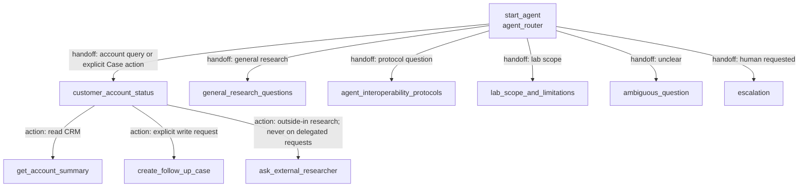

# Agent Spec: A2ALab_Research_Assistant_OpenAI

Status: approved and implemented 2026-11-02; published/activated as version 3.

## Purpose & Scope

This existing Agentforce service agent is the Salesforce half of the OpenAI ↔ Agentforce
experiments. It grounds account questions in CRM, delegates outside-in research to the paired
OpenAI agent when appropriate, and will add one tightly scoped write action: create a follow-up
Case only when a user explicitly asks for that CRM action.

This change supports the customer-memory story: OpenAI recalls a customer's durable Data 360
context, decides that the remembered next step should be performed, and asks Agentforce—the
platform that owns the CRM record and credentials—to create the Case.

## Behavioral Intent

- Keep the current hub-and-spoke routing and all existing topics.
- Route explicit requests to create or log a support Case to `customer_account_status`.
- Create a Case only after the current user message explicitly asks to create/log/open one. A
  recommendation found in recalled memory is context, not authorization by itself.
- Resolve the Account by exact name. Return a clear not-found result rather than attaching the
  Case to a guessed or partially matched account.
- Create at most one Case for one action invocation. After success or failure, report the exact
  action outputs and do not call the action again in the same reasoning cycle.
- Keep Data 360 memory attribution in the calling OpenAI agent. Agentforce reports the CRM action
  result; it does not claim to have retrieved the customer's memory.
- Preserve the D27 delegation guard: a delegated request may perform this terminal CRM action but
  must not call `ask_external_researcher`, preventing an OpenAI → Agentforce → OpenAI loop.
- Use user-mode SOQL and DML. Return bounded, non-sensitive error messages to the agent.

## Subagent Map

All router transitions are permanent handoffs. There are no subagent delegations. The
`ask_external_researcher` action is an external A2A delegation implemented by Apex and the lab
bridge, not an Agent Script subagent transition.

## Variables

No new variables are required. The existing linked Messaging variables remain unchanged. Action
loop prevention uses slot-filled inputs plus explicit post-action instructions rather than mutable
session state.

## Actions & Backing Logic

### get_account_summary (`customer_account_status`)

- **Target:** `apex://A2ALabGetAccountSummary`
- **Backing Status:** EXISTS
- **Change:** none

### ask_external_researcher (`customer_account_status`)

- **Target:** `apex://A2ALabInvokeRemoteAgent`
- **Backing Status:** EXISTS
- **Change:** none; remains prohibited when the D27 delegation rider is present

### create_follow_up_case (`customer_account_status`)

- **Target:** `apex://A2ALabCreateFollowUpCase`
- **Backing Status:** IMPLEMENTED AND DEPLOYED
- **Authorization:** visible to the model in the account topic, but instructions permit invocation
  only for an explicit Case-creation request in the current user message

#### Inputs

| Name | Type | Required | Source |
|---|---|---:|---|
| `accountName` | string | Yes | Exact Account name from the user's request |
| `subject` | string | Yes | Concise Case subject derived from the explicit request |
| `details` | string | Yes | Symptoms, endpoints, attempted timeout change, impact, owners, and runbook link when supplied |
| `priority` | string | No | `Low`, `Medium`, `High`, or `Critical`; defaults to `Medium` |

#### Outputs

| Name | Type | Visible to User? | Source | Notes |
|---|---|---:|---|---|
| `isSuccess` | boolean | No | Computed | Internal success flag |
| `caseNumber` | string | Yes | Inserted Case | Human-readable confirmation |
| `caseId` | string | No | Inserted Case | Internal traceability only |
| `errorMessage` | string | Yes | Validation/DML handling | Safe failure explanation |
| `errorType` | string | No | Validation/DML handling | Stable diagnostic category |

#### Implementation Requirement

Create invocable Apex class `A2ALabCreateFollowUpCase` with one bulkified
`@InvocableMethod`. It must:

1. validate required strings, subject/detail bounds, and the priority allow-list;
2. query exact Account names once with `WITH USER_MODE`;
3. build all valid Cases with `Status='New'` and `Origin='Web'`;
4. insert once in user mode with partial-success handling;
5. return one response per request in the original order, including `CaseNumber` on success; and
6. never log request details or expose stack traces.

Add `A2ALabCreateFollowUpCaseTest` covering success, unknown Account, validation, partial failure,
and bulk invocation. Grant Apex-class access and Case create permission in
`A2ALab_Agent_Actions` for the default agent user.

## Gating Logic

- **Case creation authorization:** subjective model instruction plus an exact action description:
  invoke only when the current user explicitly requests creation/logging/opening of a Case. Memory
  content may motivate the request but cannot authorize it.
- **Delegation loop gate:** when `[A2A-LAB DELEGATION]` is present, `ask_external_researcher` is
  prohibited. `create_follow_up_case` remains available because it is the terminal system-of-record
  action requested by the calling OpenAI agent.
- **Unknown account gate:** enforced deterministically in Apex; no exact Account means no DML.
- **Input and CRUD/FLS gates:** enforced deterministically in Apex before DML and by user-mode data
  access.
- **Action-loop gate:** after an action result, instructions require a direct text response naming
  `caseNumber` or `errorMessage`, prohibit a second call, and prohibit `show_command`.

## Architecture Pattern

Existing hub-and-spoke router with domain and guardrail subagents. This change adds one terminal
system-of-record action to the existing account-status spoke; it does not add a new subagent or a
new delegation edge.

## Agent Configuration

- **developer_name:** `A2ALab_Research_Assistant_OpenAI`
- **agent_label:** `A2ALab Research Assistant (OpenAI-paired)`
- **agent_type:** `AgentforceServiceAgent` (existing service agent with Messaging context and human
  escalation)
- **default_agent_user:** unchanged from the existing `.agent` definition (environment-specific;
  not duplicated into this design document)
- **environment verification:** the configured A2A Lab target is connected; the existing default
  agent user is active with the Einstein Agent license
- **permissions verified:** `A2ALab_Agent_Actions` grants Case create and Apex-class access to
  `A2ALabCreateFollowUpCase`

## Acceptance Criteria

1. Agent Script validates and publishes after the Apex action exists.
2. Apex tests and relevant existing tests pass with deploy coverage at or above 75%.
3. Live preview of an explicit request creates exactly one Case on Acme Corp and returns its Case
   number in direct text.
4. A non-action account question remains read-only.
5. A delegated explicit action request creates the Case without calling OpenAI back.
6. Unknown accounts and insufficient permissions create no record and return an honest failure.

## Implementation Evidence

- Agent Script validation, metadata deployment, publication, and v3 activation succeeded.
- `A2ALabCreateFollowUpCaseTest`: 3/3 pass; 75% focused coverage, including 251 requests.
- Draft live action created exactly one High-priority New Case on Acme Corp and returned Case
  `00001880` in both the function output and direct response.
- Published negative test rejected a nonexistent exact Account and reported that no Case was
  created.
- Published delegated action created Case `00001881`; the trace contains only
  `create_follow_up_case` and no `ask_external_researcher` callback.
- Hosted Maya recall-and-act created Case `00002134`; the response separately attributed Data 360
  memory and the Agentforce action, and the trace recorded both platform legs.
- The Case-routing automation moves created records to a queue before the action can reread them.
  The user-mode insert remains the authorization boundary; a scoped `without sharing` helper reads
  only `CaseNumber` for the exact successful `SaveResult` ids.
